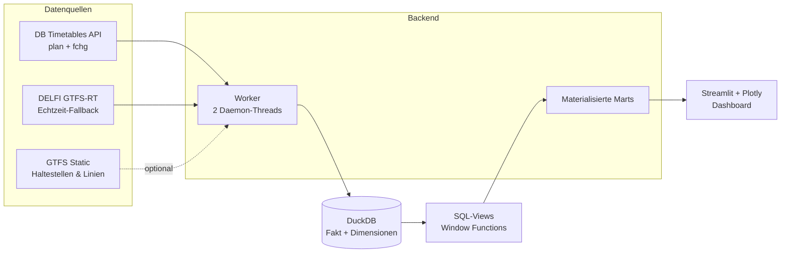

<div align="center">

# 🚆 Kettenblick

### Wenn eine Minute Verspätung zur Kettenreaktion wird.

**Ein Live-Dashboard für den deutschen Schienenverkehr – vom ersten Signal bis zur letzten Anschlussverbindung.**

[](https://2kettenblick-attpjk4i6aodt37l6bnq5d.streamlit.app/)


</div>

---

```text
┌──────────────────────────────────────────────────────────────┐
│  ABFAHRT   ZUG       ZIEL                  STATUS            │
├──────────────────────────────────────────────────────────────┤
│  10:17     ICE 573   Hamburg Hbf           +12 Min  🟡       │
│  10:19     RE 4      Fulda                 + 3 Min  🟢       │
│  10:24     IC 2045   Kassel-Wilhelmshöhe   +27 Min  🔴       │
│  10:31     S 3       Frankfurt (M) Hbf     + 8 Min  🟡       │
└──────────────────────────────────────────────────────────────┘
```

> **„Der ICE hat doch nur acht Minuten."**
> Acht Minuten in Fulda. Zwanzig in Kassel. Vierzig in Hannover.
> Genau diese Kette macht **Kettenblick** sichtbar.

---

## 🎯 Worum geht es?

Verspätungen bleiben selten dort, wo sie entstehen. Ein verspäteter Zug blockiert
einen engen Anschluss, ein Anschluss verzögert den nächsten Zug, und aus einer
kleinen Störung wird eine **Kettenreaktion über hunderte Kilometer**.

Klassische Anzeigen sagen: *„Zug X hat 8 Minuten Verspätung."*
Kettenblick beantwortet stattdessen:

- **Wo entsteht die Verspätung?**
- **Welche Minuten werden stromabwärts weitergegeben?**
- **Welcher Bahnhof ist der eigentliche Flaschenhals?**
- **Welche Anschlüsse platzen – und was kostet Warten?**
- **Welcher Zug muss priorisiert werden, um die Kaskade zu stoppen?**

Dazu verbindet das Projekt **Fahrplandaten** mit **Live-Änderungen** der
Deutschen Bahn, modelliert den Verlauf in **DuckDB** und visualisiert ihn in
**Streamlit + Plotly** – im Look eines deutschen Abfahrtsmonitors.

---

## ✨ Funktionen

| | Funktion | Beschreibung |
|---|---|---|
| 📊 | **Live-KPIs** | Überwachte Züge, aktive kritische Warnungen, maximale kumulierte Verspätung, Hauptengstelle |
| 🗺️ | **Bildfahrplan** | Zeit-Weg-Diagramm: jeder Zug eine Linie, gestrichelt = Plan, durchgezogen = Realität |
| ⏱️ | **Flaschenhals-Ranking** | Ausbreitungsfaktor pro Bahnhof: erzeugte Minuten stromabwärts je verlorener Minute |
| 📈 | **Verspätungskaskade** | Kumulierte Verspätung je Bahnhof und Zug – sortiert nach Priorität |
| 🔗 | **Anschlussrisiko** | Gefährdete und verpasste Anschlüsse inklusive Handlungsempfehlung |
| 🧾 | **Verspätungsursachen** | Aktive Netzstörungen aus dem Live-Feed plus Ursache je Zug |
| 🎛️ | **Geo-Filter** | Bundesland → Stadt, wirkt auf KPIs, Diagramme und Tabellen |
| 🔄 | **Auto-Refresh** | UI aktualisiert sich alle 5 Sekunden, ohne Voll-Rerun (`st.fragment`) |
| ⚙️ | **Entkoppelte Ingestion** | Hintergrund-Worker schreibt alle 60 Sekunden, die UI liest nur fertige Marts |
| ☁️ | **Cloud-ready** | Läuft auf Streamlit Community Cloud, inklusive Secrets und Fallback-Feed |

### Statuslogik

| Status | Bedeutung |
|---|---|
| 🔴 **KRITISCH** | kumulierte Verspätung **≥ 15 Minuten** |
| 🟡 **WARNUNG** | kumulierte Verspätung **> 5 Minuten** |
| 🟢 **PÜNKTLICH** | bis einschließlich 5 Minuten |

---

## 🧠 Die Idee in einem Satz

> **Nicht der Zug ist das Problem – die Kette ist es.**

Kettenblick betrachtet jeden Zug als eine **Folge von Halten**. Die Verspätung
eines Halts wird zur Eingangsverspätung des nächsten Halts. So entsteht eine
Kaskade, die sich mathematisch mit **Fensterfunktionen** sauber abbilden lässt:

```sql
SUM(retraso_estacion) OVER (
    PARTITION BY id_tren
    ORDER BY secuencia, id_estacion
    ROWS BETWEEN UNBOUNDED PRECEDING AND CURRENT ROW
) AS retraso_acumulado_domino
```

Daraus entstehen drei zentrale Kennzahlen:

| Kennzahl | Formel / Bedeutung |
|---|---|
| `retraso_estacion` | Verspätungszuwachs gegenüber dem vorherigen Halt |
| `retraso_acumulado_domino` | Summe aller Zuwächse bis zu diesem Halt |
| `indice_propagacion` | stromabwärts erzeugte Minuten ÷ hier verlorene Minuten |

Ein Bahnhof mit **Faktor 2,7** bedeutet: *Eine hier verlorene Minute erzeugt
stromabwärts 2,7 Minuten Verspätung.* Genau solche Knotenpunkte lohnen sich
zuerst zu entlasten.

---

## 🏗️ Architektur



### Warum ein Worker?

Die Ingestion ist langsam: Netzwerk, XML-Parsing, hunderte Züge. Die UI darf
darauf nicht warten. Deshalb laufen **zwei Daemon-Threads** getrennt vom
Streamlit-Rerun:

- **`_bucle_ingesta`** – holt alle 60 Sekunden Fahrplan + Live-Änderungen und
  ersetzt die Faktentabelle atomar.
- **`_bucle_zugnummer`** – löst optional echte Zugnummern über die DB-API auf.
- **`materializar_marts()`** – schreibt kleine, fertige Tabellen für die UI.
- Schreibzugriffe werden über einen **Lock** serialisiert.

Ergebnis: Der 5-Sekunden-Refresh der Oberfläche kostet nur Millisekunden.

---

## 🔌 Datenquellen

| Quelle | Endpoint | Inhalt | Rolle |
|---|---|---|---|
| **DB Timetables API** | `plan/{eva}/{datum}/{stunde}` | Fahrplan je Bahnhof und Stunde, inkl. Zugnummer und Laufweg | **Primär** |
| **DB Timetables API** | `fchg/{eva}` | Live-Änderungen (IRIS): reale Ankunft/Abfahrt, Ursachen, Meldungen | **Primär** |
| **DELFI GTFS-Realtime** | `realtime.gtfs.de/realtime-free.pb` | Trip-Updates und Service-Alerts | **Fallback** |
| **GTFS Static (DELFI)** | `download.gtfs.de/germany/free/latest.zip` | Haltestellen, Linien, Fahrten (~290 MB) | Optional für Fallback |
| **DB Station Lookup** | `station/{name}` | Auflösung Haltestelle → EVA | Optional für Fallback |

### Warum zwei Quellen?

Der kostenlose DELFI-Feed liefert **echte Live-Verspätungen**, aber überwiegend
Regional-, S-Bahn- und Busverkehr. Die **DB Timetables API** liefert dagegen die
echten **Fernverkehrszüge mit Zugnummer** (z. B. `ICE 573`) und deren Laufweg.

Kettenblick nutzt daher:

1. **DB-API**, wenn Zugangsdaten vorhanden sind → echte, identifizierbare Züge.
2. **GTFS-RT**, wenn keine Zugangsdaten oder die API nicht erreichbar ist →
   trotzdem ein funktionierendes Live-Dashboard (max. 1.500 Fahrten pro Zyklus).

Die beiden Welten werden **nicht vermischt**: GTFS-`trip_id`s und DB-`<s id>`s
sind unterschiedliche Schlüssel. Jede Quelle hat ihren eigenen Pfad.

---

## 🗃️ Datenmodell

**Faktentabelle `registro_trenes`** – eine Zeile = ein Zug an einem Halt:

| Spalte | Bedeutung |
|---|---|
| `id_tren` | Zugschlüssel (API-Zugnummer oder GTFS-`trip_id`) |
| `id_estacion` / `nombre_estacion` | Haltestelle (EVA bzw. GTFS-`stop_id`) + Name |
| `ciudad` / `region` | Stadt und Bundesland |
| `hora_programada` / `hora_real` | Plan- und Ist-Zeit |
| `secuencia` | Position im Laufweg |
| `tipo_tren` | ICE, IC, EC, RE, RB, S, Güterzug … |
| `prioridad` | Priorität (1 = höchste) |
| `motivo_retraso` | Kategorisierte Ursache |
| `retraso_incremental` | Zuwachs gegenüber dem vorherigen Halt (Minuten) |
| `fuente` | Herkunft: DB-API, GTFS-RT oder historisch |

**Dimensionen:** `dim_estacion`, `dim_tren`, `dim_tren_zug`,
`dim_estacion_eva`, `dim_plan_parada`, `alerta_red`, `meta_ingesta`.

**Analytische Views:**

| View / Mart | Zweck |
|---|---|
| `v_efecto_domino` | Verspätung je Halt, kumuliert und mit Status |
| `v_anschluss_riesgo` | Anschlussmarge, verpasste Anschlüsse, Handlungsempfehlung |
| `v_resumen_tren` | Endzustand je Zug |
| `mart_tren_etiqueta` | Anzeigename, Linie, Zugnummer, Laufweg |
| `mart_flaschenhals` | Engstellen je Bahnhof, Stadt und Region |
| `mart_anschluss` | Vorberechnetes Anschlussrisiko |
| `mart_causas_red` | Aggregierte Störungen im Netz |

---

## 📁 Projektstruktur

```text
.
├── app.py              # Streamlit-Dashboard, Filter, Diagramme, Tabellen
├── database.py         # DuckDB-Schema, Views, Marts, What-If-Szenarien
├── ingest.py           # DELFI GTFS-RT + GTFS Static (Fallback)
├── ingest_api.py       # DB Timetables API: plan + fchg → echte Züge
├── ingest_db.py        # DB-API-Client, EVA-Auflösung, Zugnummern
├── worker.py           # Hintergrund-Ingestion, Marts, Status
├── requirements.txt    # Abhängigkeiten
├── runtime.txt         # Python-Version für Streamlit Cloud
├── .streamlit/
│   ├── config.toml     # Abfahrtsmonitor-Theme (schwarz/amber/DB-rot)
│   └── secrets.toml    # Lokale Zugangsdaten (nicht versioniert)
└── trenes_mvp.duckdb   # Wird automatisch erzeugt
```

---

## 🚀 Schnellstart

### 1. Repository klonen

```bash
git clone https://github.com/dgoo24/2_Kettenblick.git
cd 2_Kettenblick
```

### 2. Virtuelle Umgebung anlegen

**Windows (PowerShell)**

```powershell
py -m venv .venv
.\.venv\Scripts\Activate.ps1
```

**macOS / Linux**

```bash
python3 -m venv .venv
source .venv/bin/activate
```

### 3. Abhängigkeiten installieren

```bash
pip install -r requirements.txt
```

### 4. Zugangsdaten hinterlegen (optional, aber empfohlen)

Ohne Zugangsdaten startet das Dashboard im **GTFS-RT-Fallback**. Für echte
Fernverkehrszüge mit Zugnummer:

1. Registriere dich im
   [DB API Marketplace](https://developers.deutschebahn.com/db-api-marketplace/).
2. Erstelle eine Anwendung und abonniere das Produkt **Timetables**.
3. Lege `.streamlit/secrets.toml` an:

```toml
DB_CLIENT_ID = "deine-client-id"
DB_API_KEY   = "dein-api-key"
```

Alternativ funktionieren die Umgebungsvariablen `DB_CLIENT_ID` und `DB_API_KEY`.
Die Datei steht in `.gitignore` und wird **nicht** versioniert.

### 5. Starten

```bash
streamlit run app.py
```

Das Dashboard öffnet sich unter `http://localhost:8501`.
Bei belegtem Port: `streamlit run app.py --server.port 8502`.

---

## ⚙️ Konfiguration

| Einstellung | Ort | Standard | Bedeutung |
|---|---|---|---|
| `DB_CLIENT_ID` | Secrets / Env | – | Client-ID der DB Timetables API |
| `DB_API_KEY` | Secrets / Env | – | API-Key der DB Timetables API |
| `INTERVALO_INGESTA_S` | `worker.py` | `60` | Sekunden zwischen zwei Ingestion-Zyklen |
| `MAX_TRIPS` | `worker.py` | `1500` | Obergrenze für den GTFS-RT-Fallback |
| `horas_adelante` | `ingest_api.py` | `1` | Zusätzliche Fahrplanstunden pro Abfrage |

Die DB-API wird für **24 Fernverkehrsknoten** abgefragt – darunter Berlin Hbf,
Hamburg Hbf, München Hbf, Köln Hbf, Frankfurt (M) Hbf, Stuttgart Hbf, Hannover
Hbf, Leipzig Hbf, Dresden Hbf, Nürnberg Hbf und Kassel-Wilhelmshöhe.

---

## ☁️ Deployment auf Streamlit Community Cloud

1. Repository mit Streamlit verbinden.
2. Als Einstiegspunkt `app.py` wählen.
3. Unter **App settings → Secrets** die Zugangsdaten eintragen:

```toml
DB_CLIENT_ID = "deine-client-id"
DB_API_KEY   = "dein-api-key"
```

4. Nach Änderungen an Secrets oder Modulen: **Reboot app** ausführen.
5. Bei privatem Repository muss die Streamlit-GitHub-App Zugriff haben
   ([Installation konfigurieren](https://github.com/apps/streamlit-community-cloud)).

Der Worker startet automatisch mit der App. Die Datenbank wird beim ersten Start
neu aufgebaut; es müssen keine Dateien mitgeliefert werden.

---

## 🧪 Lokale Diagnose

```bash
# Datenbestand und Kennzahlen prüfen
python database.py

# Nur die Ingestion testen
python ingest_api.py

# GTFS-RT-Fallback testen
python ingest.py
```

---

## ⚠️ Grenzen & Hinweise

- **Kein vollständiges Netzabbild.** Die DB-API-Abfrage deckt 24 große
  Knotenbahnhöfe ab; Regionallinien erscheinen vor allem über den GTFS-RT-Fallback.
- **API-Limit.** Die Timetables API erlaubt etwa **60 Requests pro Minute**.
  Ein Zyklus kann dieses Limit erreichen; HTTP `429` wird automatisch mit
  Backoff wiederholt.
- **Fahrplan ≠ Echtzeit.** `plan/{eva}` liefert nur den Soll-Fahrplan. Reale
  Zeiten kommen ausschließlich aus `fchg/{eva}`, verknüpft über die `<s id>`.
- **Ursachen sind begrenzt.** Der kostenlose DELFI-Feed liefert Ursachen meist
  nur als Freitext auf Netzebene. Die Zuordnung zum einzelnen Zug ist daher
  nicht immer möglich (`Keine Feed-Information`).
- **GTFS-RT-Fallback.** Ohne DB-Zugangsdaten werden max. 1.500 Fahrten pro
  Zyklus verarbeitet; die Zugnummern-Auflösung liegt dort bei etwa 70 %.
- **Keine amtliche Quelle.** Alle Daten stammen von Dritten und dienen der
  Analyse und Demonstration, nicht der Betriebssteuerung.

---

## 🛠️ Technologie-Stack

| Schicht | Technologie |
|---|---|
| Sprache | Python 3.12+ |
| Data Warehouse | DuckDB (spaltenorientiert, embedded) |
| Analytik | SQL mit Fensterfunktionen, Kimball-Sternschema |
| Ingestion | `requests`, `xml.etree`, `gtfs-realtime-bindings`, `pandas` |
| Visualisierung | Streamlit, Plotly |
| Betrieb | Daemon-Threads, materialisierte Marts, Auto-Refresh |
| Deployment | Streamlit Community Cloud |

---

## 🎨 Design

Das Theme orientiert sich an den **Abfahrtsmonitoren der Deutschen Bahn**:

- tiefes Schwarz als Hintergrund,
- Amber für Text und Akzente,
- DB-Rot `#EC0016` für kritische Zustände,
- Signalgrün für Pünktlichkeit,
- Monospace-Schrift (`JetBrains Mono`) für den Anzeigetafel-Look.

---

## 📜 Daten & Danksagung

- Fahrplan- und Echtzeitdaten: **Deutsche Bahn AG**, DB API Marketplace
  (Timetables), Lizenz **CC BY 4.0**.
- Open-Data-Feed: **DELFI / gtfs.de**.
- Dieses Projekt steht in **keiner offiziellen Verbindung** zur Deutschen Bahn AG.

---

<div align="center">

**Gute Fahrt. Und möge die Kette nie reißen.** 🚆

[⬆ Nach oben](#-kettenblick)

</div>
